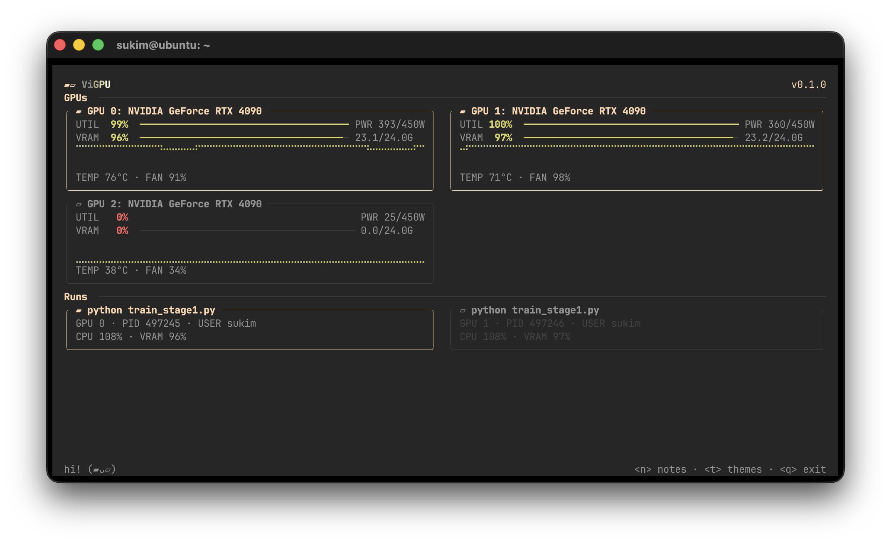

# ViGPU



```
▰▱ ViGPU

hi! (▰ᴗ▱)
```

A simple, pretty GPU monitoring TUI.

## Install and run

### Debian or Ubuntu

```sh
sudo install -d -m 0755 /etc/apt/keyrings
curl -fsSL https://seon.uk/vigpu/vigpu-archive-keyring.asc | sudo gpg --dearmor -o /etc/apt/keyrings/vigpu.gpg
echo "deb [arch=amd64 signed-by=/etc/apt/keyrings/vigpu.gpg] https://seon.uk/vigpu stable main" | sudo tee /etc/apt/sources.list.d/vigpu.list
sudo apt update && sudo apt install vigpu
vigpu
```

### Linux without sudo

```sh
curl -fsSL https://seon.uk/vigpu/install.sh | sh
export PATH="$HOME/.local/bin:$PATH"
vigpu
```

If `vigpu` is not found, add the `export PATH` line to your shell profile and open a new terminal. An NVIDIA driver is required.

### Windows PowerShell

```powershell
irm https://seon.uk/vigpu/install.ps1 | iex
vigpu
```

If `vigpu` is not found, open a new PowerShell window. An NVIDIA driver is required.

### macOS on Apple Silicon

```sh
brew install snkii/vigpu/vigpu
vigpu
```

ViGPU quietly checks the published platform binary each time it starts. It detects changed release assets even when the version number stays the same, verifies the downloaded file, and applies the update after you exit. If the network is unavailable, ViGPU starts and works normally; it checks again the next time it opens.

To skip the background update check for one run, use `vigpu --no-update`. Set `VIGPU_NO_UPDATE=1` to disable checks by default (`$env:VIGPU_NO_UPDATE = "1"` in PowerShell). Remove the variable or set it to `0` to re-enable checks.

## License

ViGPU is available under either the [MIT License](LICENSE-MIT) or [Apache License, Version 2.0](LICENSE-APACHE).

## Contact

[iamseonuk@gmail.com](mailto:iamseonuk@gmail.com)
